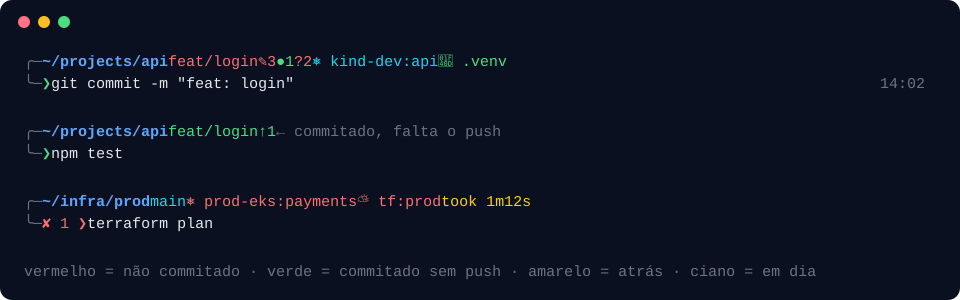

# devkit

Um comando para deixar um Linux novo (ou WSL) pronto para desenvolver: instala as ferramentas de terminal que eu uso todo dia, configura o zsh sem oh-my-zsh e traz um prompt que mostra o estado do git sem você precisar digitar `git status`.

<p align="center"></p>

```bash
git clone https://github.com/yurilopesmdv/devkit ~/devkit
cd ~/devkit && ./install.sh --dry-run   # veja o que vai acontecer
./install.sh                            # instala de verdade
```

## O que vem

| | |
|---|---|
| **Prompt** | usuário (vermelho se root; host em SSH), pasta, branch colorida pelo estado com hash curto, contadores, ↑↓ do remoto, stash, ✔ quando limpo, contexto/namespace do Kubernetes, perfil da AWS, workspace do Terraform (prod vermelho, qa/hml amarelo), versões de node/rust/go dentro de projetos, venv, jobs em segundo plano, tempo de comandos lentos, código de erro, data e hora, título da janela. Uma chamada ao `git` por prompt. |
| **Ferramentas** | `fzf`, `ripgrep`, `fd`, `bat`, `eza`, `zoxide`, `delta`, `lazygit`, `yq`, `jq`, `direnv`, `tmux`, `btop`/`htop`, `tree` |
| **zsh** | autosuggestions, syntax highlighting, completions extras com cache (inclusive aws, terraform, az, helm, kubectl), histórico grande e compartilhado, busca com ↑/↓, Shift+Tab, pilha de diretórios (`d`, `1`–`9`), asdf e Homebrew/Linuxbrew se existirem |
| **Aliases** | **todos** os do oh-my-zsh para git (204) e kubectl (118) — `gst`, `gcmsg`, `gpsup`, `kgp`, `kcuc`… — sem precisar do oh-my-zsh; mais docker, terraform, azure, `pkgi`/`pkgu` (mesmo comando em qualquer distro), `take`, `gbf` (branch com fzf), `pbcopy`/`pbpaste` e `open` no WSL. Só são criados se a ferramenta existir. |
| **`devkit`** | `doctor`, `update`, `ports`, `extract`, `serve`, `wsl dns` |

### Cores do prompt

| Branch | Significa |
|---|---|
| 🔴 vermelha | há alterações não commitadas (`✎` alterados, `?` novos) |
| 🟢 verde | tudo commitado, mas ainda não sincronizado (`↑` commits à frente) |
| 🟡 amarela | o remoto tem commits que você não tem (`↓`) |
| 🔵 ciano | em dia com o remoto |

Outros sinais: `●` staged · `✖` conflitos · `≡` stashes · `(local)` branch sem upstream · contexto do k8s e workspace do Terraform ficam **vermelhos quando o nome contém `prod`**.

### Vindo do oh-my-zsh?

O devkit cobre o que um setup típico de oh-my-zsh faz e abre mais rápido (medido aqui: **163 ms** contra 197 ms com oh-my-zsh + git/kubectl/autosuggestions/syntax-highlighting). Dos plugins do oh-my-zsh, só os arquivos `git` e `kubectl` são baixados (licença MIT) para manter os aliases idênticos.

## Distros

Testado no CI a cada push: **Ubuntu 20.04 e 24.04, Debian 12, Fedora 41 e Arch**. Também funciona em openSUSE (zypper), macOS (brew) e WSL.

Quando a distro não tem um pacote (ex.: `eza` e `lazygit` no Ubuntu 20.04), o instalador baixa o binário do release oficial no GitHub para `~/.local/bin` — sem root.

## Seguro de rodar

- `--dry-run` mostra cada comando antes de executar.
- Seu `~/.zshrc` vira backup (`~/.zshrc.devkit-backup-<data>`) e as linhas dele ficam **comentadas** em `~/.config/devkit/local.zsh` para você reaproveitar o que quiser.
- `./uninstall.sh` restaura o backup.
- Rodar de novo é seguro: atualiza plugins e não duplica nada.

```text
./install.sh [--dry-run] [--no-packages] [--no-releases] [--no-shell] [--no-chsh]
```

## Personalizar

Tudo seu vai em `~/.config/devkit/local.zsh` (carregado por último). Ajustes do prompt:

```zsh
DEVKIT_PROMPT_GIT=0              # desliga o git (monorepos enormes)
DEVKIT_PROMPT_K8S=0              # esconde o contexto do Kubernetes
DEVKIT_PROMPT_TIME=0             # sem a hora à direita
DEVKIT_PROMPT_SLOW_SECONDS=5     # "took" só a partir de 5s
DEVKIT_PROMPT_PROD_PATTERN=prd   # o que conta como produção
```

## Estrutura

```text
install.sh / uninstall.sh   instalação idempotente e reversível
lib/                        detecção de distro, pacotes e releases do GitHub
zsh/devkit.zsh              ponto de entrada (opções, completions, plugins)
zsh/prompt.zsh              o prompt
zsh/aliases.zsh, tools.zsh  aliases e integrações (fzf, zoxide, delta, nvm, kubectl)
bin/devkit                  CLI de utilidades
tests/                      testes do prompt com repositórios git reais
```

## Próximas ideias

- `devkit new <stack>` integrando com o [rust-devtool](https://github.com/yurilopesmdv/rust-devtool)
- módulo de linguagens (node via fnm, python via uv, rust, go) com `--with`
- `devkit wsl` com `.wslconfig` otimizado e sincronização de chaves SSH
- tmux com tema combinando e atalhos
- verificação de checksum dos binários baixados

## Licença

[MIT](LICENSE)
